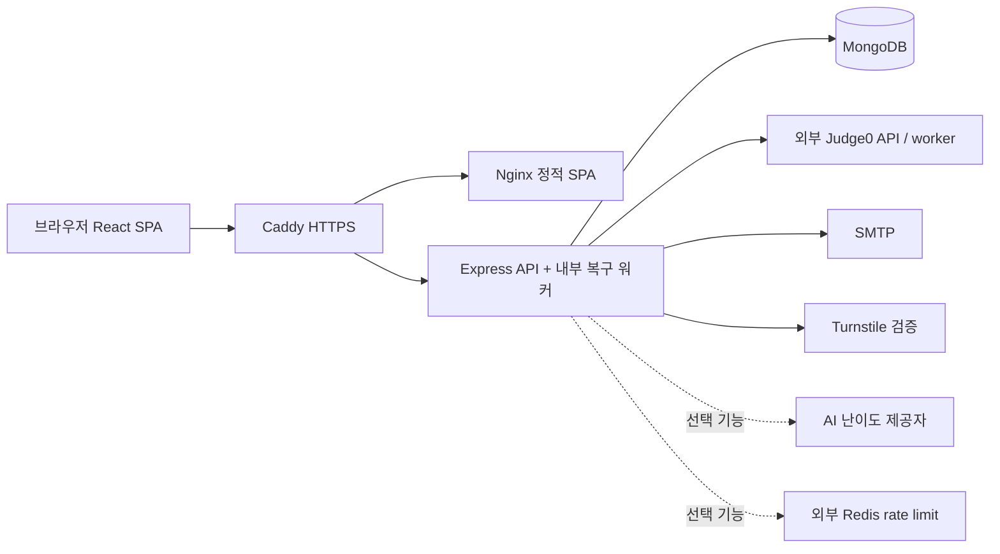

# WBOJ 아키텍처

저장소 코드 기준 구성이다. 배포 인스턴스의 상태·비밀값은 이 문서의 범위 밖이다.

## 구성과 경계

- `docker-compose.yml`은 `mongo`, `backend`, `frontend`, `caddy`를 실행한다. `mongo-express`는 `tools` profile이다. Judge0·Redis·SMTP·AI는 포함하지 않는다.
- Caddy는 `/api/*`를 API로, 나머지는 Nginx로 보낸다. Nginx는 정적 파일과 SPA history fallback, `/api/` 프록시를 제공한다.
- MongoDB가 문제·제출·세션·레이팅의 영속 저장소다. 이미지 파일은 backend의 `uploads/problems`에 있고 Compose 볼륨으로 보존한다.

## 코드 지도

| 영역 | 진입점 / 책임 |
| --- | --- |
| API 프로세스 | `backend/src/server.js`: DB 연결 → 레이팅 backfill → HTTP listen → 내부 워커 시작, 종료 시 연결 정리 |
| HTTP 공통 | `backend/src/app.js`: Helmet/CORS/request ID/JSON/cookie/logging/SEO/static/라우터/에러 처리 |
| 설정 | `backend/src/config/env.js`, `backend/src/config/auth.js`, `backend/src/config/database.js`, `backend/src/config/email.js` |
| 기능별 처리 | `backend/src/routes/` → `backend/src/controllers/` → `backend/src/services/` → `backend/src/models/`; 요청 스키마는 `backend/src/validation/`의 Zod |
| SPA 부트스트랩 | `frontend/src/main.jsx`: QueryClient, BrowserRouter, AuthProvider |
| 화면 라우팅 | `frontend/src/App.jsx`: lazy page import, `/` → `/dashboard`, `/dashboard/submissions` → `/submissions` |
| API/인증 상태 | `frontend/src/context/AuthContext.jsx`: access token 보관, 요청·refresh·로그아웃과 개인 query cache 정리 |
| 화면/레이아웃 | `frontend/src/pages/`, `frontend/src/components/Layout.jsx`, `frontend/src/components/Sidebar.jsx`, `frontend/src/components/Header.jsx`, `frontend/src/styles.css` |

## HTTP 처리와 공개 범위

요청은 공통 미들웨어 후 라우터에서 선택/필수 인증, 역할 검사, rate limiter, Zod 검증을 거쳐 controller로 전달된다. 모든 기능이 service를 경유하는 것은 아니며 controller에서 직접 모델을 조회하는 코드도 있다. 예외는 공통 handler가 `{ code, message, details? }`로 응답하며 운영 5xx의 내부 메시지는 숨긴다.

주요 API mount는 `backend/src/app.js`에 있다: `/api/auth`, `/api/session`, `/api/problems`, `/api/submissions`, `/api/judge`, `/api/languages`, `/api/dashboard`, `/api/ratings`, `/api/users`, `/api/admin/users`, `/api/announcements`, `/api/problem-updates`, `/api/uploads`.

- 공개 문제 목록/상세·제출 메타데이터·레이팅 순위는 비로그인 조회를 지원한다. 비공개 문제와 개인 데이터는 controller에서 추가로 제한한다.
- 제출 상세의 소스는 소유자 또는 admin 계열만 조회한다. 일반 공개 목록은 요약 메타데이터를 반환한다. 현재 상세 API는 비소유자에게도 testcase 결과와 runs를 남기므로, 비공개 testcase 정책 점검을 [handoff](handoff.md)에 기록했다.
- 역할은 `user < admin < super_admin`. 문제 CRUD·난이도는 admin 계열, 제출 삭제·counter 재계산·계정 권한 변경 등은 super_admin 권한을 요구한다. 문제 수정에는 저자 허용 분기도 있으므로 UI guard와 서버 권한을 함께 확인한다.
- `/api/live`는 프로세스 응답, `/api/health`는 Mongo 연결까지 검사(실패 503)한다. Judge0 가용성은 health에 포함하지 않는다.

## 제출과 채점

1. `backend/src/controllers/submissionController.js#createSubmission`이 문제·언어·소스를 검증하고 정리한다. Mongo의 고유 `activeKey=user:problem`으로 동일 사용자/문제의 진행 중 중복 제출을 막는다.
2. `Submission`을 `queued`로 저장하고 HTTP 202를 반환한다. `setImmediate`로 즉시 처리도 요청하되, 영속 queue는 Mongo에 있다.
3. `processSubmission`이 `findOneAndUpdate`로 `queued → running`을 원자적으로 선점한다. `backend/src/services/submissionService.js#evaluateSubmissionRun`이 실행 결과를 취합한다.
4. `backend/src/services/testCaseRunnerService.js`가 testcase를 순서대로 Judge0로 전송한다. 입력/소스/정답은 Base64, 실행 네트워크는 비활성화한다. 문제 메모리 MB를 Judge0 KB로 변환하고, 출력은 양끝 공백 제거 후 비교한다. 컴파일 오류이면 나머지는 SKIPPED 처리한다.
5. `backend/src/services/judge0Service.js`가 프로세스 내 요청 동시성(기본 2), timeout(20초), 재시도(기본 2회)를 적용한다. 429/5xx와 일부 연결 오류를 지수 backoff로 재시도한다. `/languages` 결과는 5분 캐시한다.
6. 점수·최종 verdict·시간/메모리·testcase 결과·실행 이력을 저장한다. `accountingPending`으로 문제 counter와 UTC 일별 통계를 복구하고, 최초 AC 및 `ratingPending`으로 레이팅을 갱신한다. 완료 시 activeKey를 제거하고 이벤트를 발행한다.
7. `backend/src/services/submissionWorkerService.js`가 기본 1초마다 queued 작업(최대 10개 조회)을 처리하고, 5분 이상 running인 작업을 재대기시킨다. 통계/레이팅의 pending 항목과 종료 시즌도 정리한다. 긴 채점과 stale 기준이 충돌하지 않도록 설정해야 한다.

재채점 `PATCH /api/submissions/:id/resubmit`은 같은 문서를 **동기적으로** 갱신한다. 소유자 또는 admin 계열이 사용할 수 있다. `submissionService.js`는 transaction을 시도하고 standalone Mongo의 미지원 오류이면 transaction 없이 실행한다. 실행 이력은 기본 최근 20개만 보존한다.

## 실시간 UI

`backend/src/services/submissionStreamService.js`는 프로세스 내 EventEmitter와 최근 500개 이벤트를 보관한다. `frontend/src/hooks/useSubmissionStream.js`는 fetch로 SSE를 읽고 재연결하며, 인증 사용자는 기본 8초마다 updates API도 조회한다. 문제별 stream은 익명 연결을 지원하지만 익명 사용자의 보조 polling은 생략한다. 이벤트는 영속 queue나 인스턴스 간 pub/sub가 아니므로 다중 backend 운영에는 별도 설계가 필요하다.

React Query가 목록·상세·통계를 캐시하고 이벤트에 따라 갱신한다. `frontend/src/components/SubmissionViewerModal.jsx`, `SubmissionFeedback.jsx`, `ProblemSubmissionsPanel.jsx`가 결과와 소스 접근 UI를 담당한다.

## 인증·콘텐츠·레이팅

- 인증: access JWT + HttpOnly refresh cookie. Mongo `User.sessions`의 refresh hash/session ID와 유휴 기한을 함께 검사한다. 단순 조회와 polling은 유휴 시간을 갱신하지 않으며, 사용자 활동과 명시적 extend가 갱신한다. [세션 상세](security/session.md).
- 문제 작성: `frontend/src/components/ProblemEditor.jsx` → 문제 API → 서버 sanitize → `frontend/src/components/ProblemStatement.jsx`의 Markdown/KaTeX 렌더링. 이미지 API는 sharp로 검증·재인코딩하고 `/api/uploads/problems/...` 경로를 편집기에 삽입한다. [작성 상세](authoring-math.md).
- 레이팅: 최초 AC → 고유 `FirstSolve` → `backend/src/services/portfolioService.js` 계산 → `RatingProfile` 캐시. `backend/src/services/ratingService.js`가 최초 AC backfill·재계산·시즌 결과 확정을 수행한다. AI 난이도는 admin의 미리보기 요청 후 명시적으로 확정한다. [정책 상세](ratings.md).
- SEO: `frontend/src/hooks/useSeo.js`, `frontend/src/utils/seo.js`, `frontend/src/utils/hreflang.js`; 정적 `frontend/public/robots.txt`, `frontend/public/sitemap.xml`과 동적 `/api/sitemap.xml`은 서로 다른 제공 경로다.
